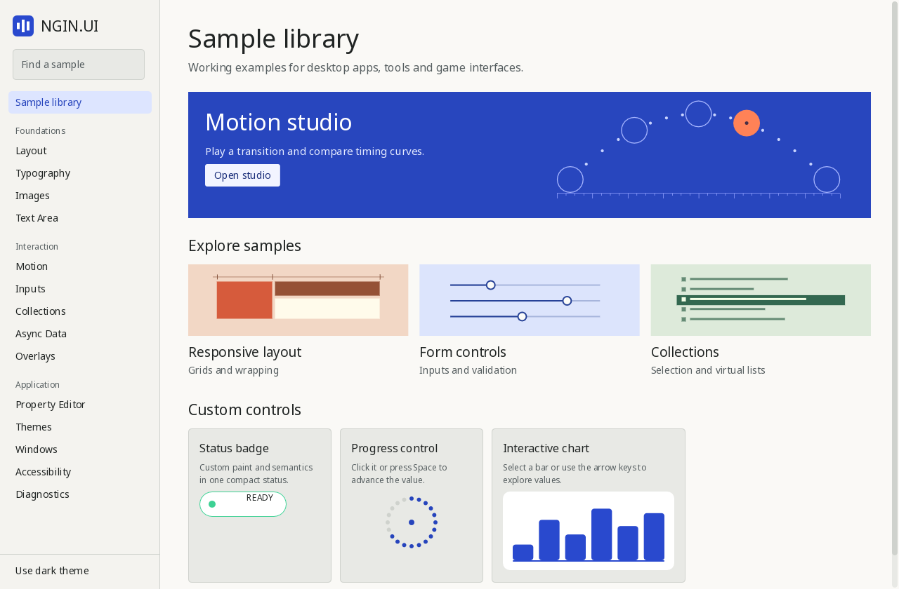
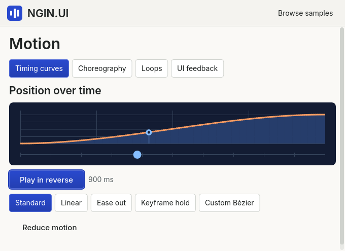

# NGIN.UI Gallery

A native C++ sample library for desktop apps, tools and game interfaces. Open a preview on the home screen, or find a topic in the searchable sidebar. In a narrow window, **Browse samples** opens the same library and **Escape** returns to the sample.



## Try a sample

- **Motion studio** puts a live timing plot and its playback button together. Switch to Choreography, Loops or UI feedback to run a different experiment.
- **Control templates** lets you switch a field-recording archive from waveform cards to file rows. A selected recording and its saved status follow it between templates. [Preview the browser](docs/gallery-templates.png).
- **Property editor** offers an inspector and a mixer for the same reflected playback settings. Change the volume in one and switch to the other.
- **Responsive layout** opens an export queue with a fixed-width format column, a content-sized status column and filenames that fill the remaining space. Narrow the queue or use longer status labels to watch the space redistribute.
- **Typography** shows Inter at different sizes and weights alongside multilingual fallback samples.
- **Form controls** opens a working track list. Change its preferences, then switch to a level meter, bound text fields or form validation.
- **Collections** lets you scroll a virtual list, change a selection or try menus and tabs.
- **Themes** lets you choose the accent, compare flat and gradient controls, and switch between light and dark. Your choices carry across pages. [See the Themes page in dark mode](docs/gallery-themes.png).



## Find the implementation

Both desktop hosts mount `MainView`. Shared application state belongs to `GalleryViewModel`. Individual studies keep transient selections in their mounted component. Follow the source for a sample here.

| To explore | Source |
| --- | --- |
| Responsive navigation, search, palette and viewport layout | [GalleryShell.cpp](src/GalleryShell.cpp) |
| Home screen, illustrated sample links and adaptive tracks | [GalleryIndex.cpp](src/GalleryIndex.cpp) |
| Window events, page registration and model | [Gallery.cpp](src/Gallery.cpp) |
| Layout, typography, text editing, and images | [GalleryBasics.cpp](src/GalleryBasics.cpp) |
| Form controls, validation, and async data | [GalleryInputs.cpp](src/GalleryInputs.cpp) |
| Lists, virtualization, tabs, and menus | [GalleryCollections.cpp](src/GalleryCollections.cpp) |
| Easing, animation controls, and awaitable motion | [GalleryMotion.cpp](src/GalleryMotion.cpp) |
| Live accent and finish editor | [GalleryThemes.cpp](src/GalleryThemes.cpp) |
| Overlays, windows, and accessibility | [GalleryTools.cpp](src/GalleryTools.cpp) |
| Rendering, glyph cache, and navigation diagnostics | [GalleryDiagnostics.cpp](src/GalleryDiagnostics.cpp) |
| Reusable Gallery controls and page layout | [GalleryViews.cpp](src/GalleryViews.cpp) |
| Keyboard-accessible sample selectors | [GallerySamplePicker.hpp](src/GallerySamplePicker.hpp) |
| A selectable clip browser with replaceable item, layout and detail templates | [GalleryTemplates.cpp](src/GalleryTemplates.cpp) |
| Inspector and mixer templates for reflected fields | [GalleryPropertyEditor.cpp](src/GalleryPropertyEditor.cpp) |
| Custom measurement, drawing, and input | [GalleryCustomControls.cpp](src/GalleryCustomControls.cpp) |

```bash
ngin build --project Examples/NGIN.UI.Gallery/NGIN.UI.Gallery.nginproj --configuration Debug --output build/manual/NGIN.UI.Gallery
ngin run --project Examples/NGIN.UI.Gallery/NGIN.UI.Gallery.nginproj --configuration Debug --output build/manual/NGIN.UI.Gallery
```

## Open a specific page

```text
--page "Control templates" explore waveform cards and file rows
--page Layout            compare fixed, content-sized and weighted tracks
--page Accessibility     open the accessibility page
--page "Property Editor" edit reflected playback settings
--smoke                  render every page, then exit
```

The [hosted Gallery](../NGIN.UI.Gallery.Hosted) uses the same screens through
`NGIN.Core`. The [headless test product](../NGIN.UI.Gallery.Tests) renders the
catalogue through deterministic test backends.

The `Release` profile can publish the versioned demo archive described in the
[0.4 release notes](../../docs/guides/ngin-ui-v0.4-release.md).

Motion choreography runs under the application’s background supervisor. Leaving the experiment cancels its controller. On exit, the application joins outstanding work before the model is released.
